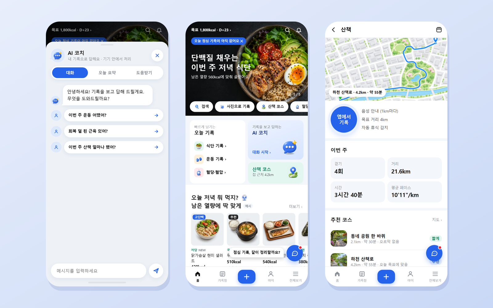

## 박준영 · AI 개발자

챗봇, LLM 애플리케이션, AI 에이전트를 만들고 배포합니다.
숫자와 안전 판단은 코드와 규칙에 맡기고, LLM에는 이해와 설명을 맡기는 구조를 좋아합니다.
지금은 식단·운동·걷기 앱 세 개를 하나로 묶은 웰니스 AI 에이전트를 만들고 있습니다.

🔗 **Portfolio** · https://junyeong-portfolio-one.vercel.app

### Now building · 웰니스 AI 에이전트

식단·혈당·근력·걷기·영양제 기록을 보고 답하는 AI 코치. LangGraph.js로 안전 판정 → 라우터 → 도메인 노드 7개 → 코치를 잇고, 숫자는 원래 앱의 계산 함수가 만들며 모델(LFM3-1.7B, d1-2B)은 PC 안에서만 돌립니다. 안드로이드 앱 + WSL 서버, 앱 화면도 직접 디자인했습니다. (개발 중 · [상세](https://junyeong-portfolio-one.vercel.app/projects/wellness-agent/))

### Selected Work

| 프로젝트 | 내용 | 역할 | 링크 |
|---|---|---|---|
| **웰니스 AI 에이전트** | 앱 세 개를 LangGraph로 묶은 로컬 AI 코치. 숫자는 도구가, 설명은 로컬 LLM이 | 개인 (설계·개발·앱 디자인, 진행 중) | [상세](https://junyeong-portfolio-one.vercel.app/projects/wellness-agent/) |
| **레모니 · AI 건강상담 챗봇** | 식단·영양·걷기·영양제 질문에 답하는 건강상담 챗봇. 위기 대응은 규칙이, 문장은 로컬 LLM이 맡는 구조 | 레몬헬스케어 수습 계약직 (설계·개발·평가) | [상세](https://junyeong-portfolio-one.vercel.app/projects/lemoni-chatbot/) |
| **KBO 원정 응원 플래너** | 경기 하나를 고르면 티켓·교통·맛집·숙소·관광을 Gemini Tool Calling 챗봇이 한 번에 구성 | 팀 (KDT 12기) | [코드](https://github.com/HorangEe02/KNU_KDT_12th/tree/main/Phase12) |
| **AJIN Compliance** 🏆 | 직원 649명의 6개 업무를 한 화면에서 처리하는 온프레미스 제조 AI 통합 콘솔 | 팀장 (Backend·LLM Router·Infra) | [코드](https://github.com/HorangEe02/Project_yeong/tree/main/04_AJIN) · [데모](https://ajin-ai-assistant-frontend.vercel.app/showcase) |
| **직장인 점심 추천 AI** | 날씨·영양·팀 선호·음식점 4축 추천 파이프라인 + NLP 7모듈 + RAG 챗봇 | 팀 (KDT 12기) | [코드](https://github.com/HorangEe02/KNU_KDT_12th/tree/main/Phase13%2614) |
| **Lemon AID** | 영양제 라벨을 OCR·로컬 LLM으로 구조화하고 KDRIs 기준으로 해석하는 헬스케어 앱 | 팀 · 영양제 분석 파트 | [코드](https://github.com/Lemon-Aid-KDT/Lemon-sin) |
| **헬창지피티** | 자연어 한 문장을 프로필 분석→식단→운동 루틴→피드백으로 잇는 로컬 LLM 코칭 파이프라인 | 팀 (KDT 12기) | [코드](https://github.com/HorangEe02/KNU_KDT_12th/tree/main/Phase11) |
| **CAD Vision** | 이미지·텍스트·구조 3채널 멀티모달 RAG로 도면 검색을 1분 이내로 줄인 검색 엔진 | 개인 | [코드](https://github.com/HorangEe02/Project_yeong/tree/main/01_CAD) |

### Awards

- 🏆 **2026** KNU×아진산업 제3회 실리 AX 기술전(AX 부문) 인기상 · AJIN Compliance
- 🏆 **2025** 계명대학교 캡스톤디자인 우수상 · 대학생 307명 설문 기반 통계분석

### Tech Stack

| 분야 | 기술 | 써 본 곳 |
|---|---|---|
| **Agent · 오케스트레이션** | `LangGraph` (Python · JS) `LlamaIndex` `Tool Calling` `Multi-Agent` | 웰니스 에이전트 그래프, 레모니, 사내 업무 에이전트 전환, KBO 플래너 |
| **LLM 런타임 · 모델** | `Ollama` `LM Studio` `llama.cpp` `Gemini API` `Vertex AI` · `Gemma 4` `Qwen 3.5` `EXAONE` `LFM3` `d1-2B` | 로컬 LLM 서빙, 클라우드↔로컬 모델 전환, 용도별 모델 비교·선택 |
| **RAG · 검색** | `ChromaDB` `pgvector` `FAISS` `BM25` 하이브리드 검색 · `bge-m3` `E5` `sentence-transformers` | 근거 문서 기반 답변, 멀티모달 도면 검색, 운동·영양 검색 |
| **평가 · 안전** | 평가 문항 세트와 실행기, 규칙 + 판정 모델 가드, 구조화 출력(JSON 스키마) 검증 | 위기 신호 판정, 금지 답변 점검, 실패 사례 반복 수정 |
| **NLP · Vision** | `PyTorch` `scikit-learn` `KcELECTRA` `PaddleOCR` `YOLO` `OpenCLIP` `GNN` | 감성 분석, 영양제 라벨 OCR, 도면 이미지 검색, 승률 예측 |
| **Backend · Data** | `Python` `FastAPI` `TypeScript` `Node.js` · `PostgreSQL` `SQLite` `Redis` `Supabase` | API 서버, 영양 DB·음식 목록 구축, 사용자 기록 저장 |
| **Frontend · App** | `Next.js` `React` `Tailwind CSS` `TanStack Query` `Three.js` `Leaflet` · `Flutter` `Android (WebView)` · `Astro` | 웹 서비스, 지도·3D 뷰어, 모바일 앱, 이 포트폴리오 |
| **Infra · Deploy** | `Docker` `Docker Compose` `Caddy` `WSL` · `Vercel` `Firebase App Hosting` | 온프레미스 배포, 로컬 모델 서버, 웹 배포 |
| **통계 · 분석** | `R` `SAS` `SQL` `Pandas` `statsmodels` | 통계학 전공, ADsP · SAS 자격 |
| **AI 코딩 도구** | `Claude Code` `Codex` | 설계와 평가 기준은 직접 정하고 구현에 활용 |

### Background

계명대학교 통계학과 · KDT 12기 수료 · ADsP · SAS Base Programming · Google AI Essentials
